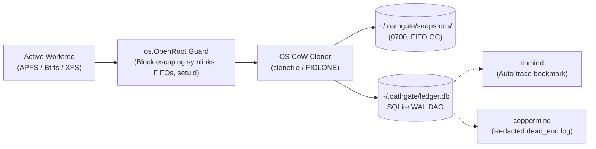

# `oathgate` (`bonjoski/oathgate`)

[](https://github.com/bonjoski/oathgate/actions/workflows/ci.yml)
[](https://github.com/bonjoski/oathgate/actions/workflows/paved-road.yml)
[](https://github.com/bonjoski/oathgate/actions/workflows/codeql.yml)
[](https://github.com/bonjoski/oathgate/releases)
[](https://golang.org)
[](https://slsa.dev)
[](https://docs.sigstore.dev)
[](LICENSE)
[-blueviolet.svg)](#security--operational-guarantees)

> [!NOTE]
> **Developer Tooling & Safe Harbor Scope:** `oathgate` is a 100% local, single-developer workstation utility built on standard OS Copy-on-Write filesystem primitives (`clonefile(2)`, `FICLONE`, `os.OpenRoot`, SQLite WAL) with zero cloud backends, zero network sockets, and zero fleet telemetry.

> **Instant Copy-on-Write Time-Travel Checkpoints for Coding Agents**  
> *Sub-10ms workspace checkpoints, reversible rewind, and parallel A/B branching — without polluting git history.*



- **Native OS Copy-on-Write:** Uses macOS APFS `clonefile(2)` (`CLONE_NOFOLLOW`) and Linux `FICLONE` ioctl (with verified `os.OpenRoot` fallback) to snapshot entire worktrees — including untracked files & build artifacts — in milliseconds with near-zero extra disk blocks.
- **Reversible Rewind:** `oathgate rewind` always takes an automatic `pre-rewind` safety snapshot under a per-worktree `flock` and refuses to run while `.git/index.lock` is active.
- **Portfolio Native:** Auto-bookmarks active [`tinmind`](https://github.com/bonjoski/tinmind) traces (`TINMIND_SESSION_ID`), scrubs diff/memory secrets with `tinmind/pkg/redact`, and logs sanitized `dead_end` lessons straight into [`coppermind`](https://github.com/bonjoski/coppermind).
- **Hardened Fail-Closed:** Rejects escaping symlinks, FIFOs/sockets/devices, and `../` snap IDs; strips `setuid`/`setgid`/`sticky` bits; enforces depth (`64`) & entry (`250,000`) caps; zero network sockets and zero Touch ID stalls across $N=8$ parallel worktrees.

---

## Install

```bash
brew install bonjoski/tap/oathgate
```

Or build from source (Go 1.27+):

```bash
go install github.com/bonjoski/oathgate/cmd/oathgate@latest
```

---

## 💡 Core Use Cases & Recipes

### 1. Pre-Refactor Checkpoint, Secret-Safe Diff & Instant Rewind

```bash
# Take an O(1) CoW checkpoint before letting an agent refactor
oathgate snap -m "before auth refactor"

# Inspect what changed (secrets in .env / logs are scrubbed automatically)
oathgate diff latest

# Roll back cleanly — Oathgate takes an automatic pre-rewind safety snap first
oathgate rewind latest
```

### 2. Rewind a Failed Agent Approach & Teach `coppermind`

```bash
oathgate rewind og-20261127-a1b2c3d4 \
  --reason "circular import introduced in pkg/auth" \
  --record-dead-end
```

### 3. Branch a Checkpoint to A/B Test Two Agent Strategies

```bash
oathgate branch og-20261127-a1b2c3d4 ../repo-try-b
```

### 4. Pin Milestones & Run Garbage Collection

```bash
oathgate pin og-20261127-a1b2c3d4
oathgate gc --max-snaps 25 --max-hours 72
oathgate doctor
```

See [docs/use-cases/01-agent-time-travel-and-rewind.md](docs/use-cases/01-agent-time-travel-and-rewind.md) for the complete `tinmind` + `oathgate` + `coppermind` workflow.

---

## Security & Operational Guarantees

| Invariant | Guarantee |
| :--- | :--- |
| **Hop Tax** | `0ms` on read-only commands; `~11ms` end-to-end on a 500-file APFS repo (with full `os.OpenRoot` pre-walk + WAL commit) |
| **Concurrency ($N=8$)** | Per-worktree `flock` inside `~/.oathgate/locks/`, SQLite WAL (`busy_timeout=5000`) outside clone I/O, 0 Touch ID stalls |
| **Path & Privilege Safety** | `CLONE_NOFOLLOW`, escaping-symlink & FIFO/socket/device refusal, strict `og-YYYYMMDD-<8-hex>` IDs, `setuid`/`setgid`/`sticky` stripped |
| **Rewind Safety** | Automatic `pre_rewind` safety snapshot before every rewind + fail-closed `.git/index.lock` guard |
| **Secret Redaction** | All `diff` previews and `--record-dead-end` Coppermind payloads scrubbed via `tinmind/pkg/redact` |

---

## License

Apache 2.0 — see [LICENSE](LICENSE).
